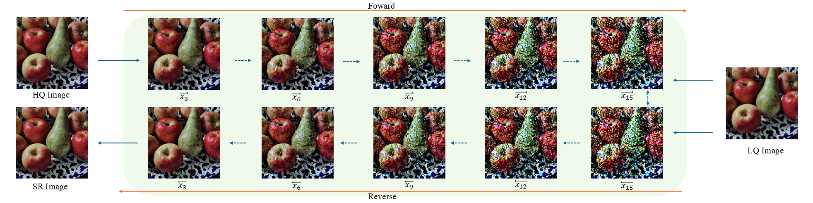
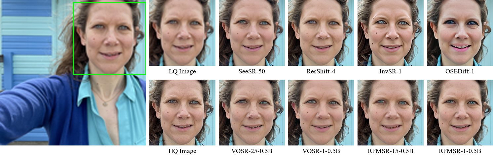
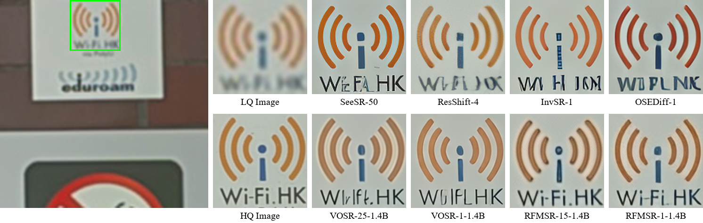
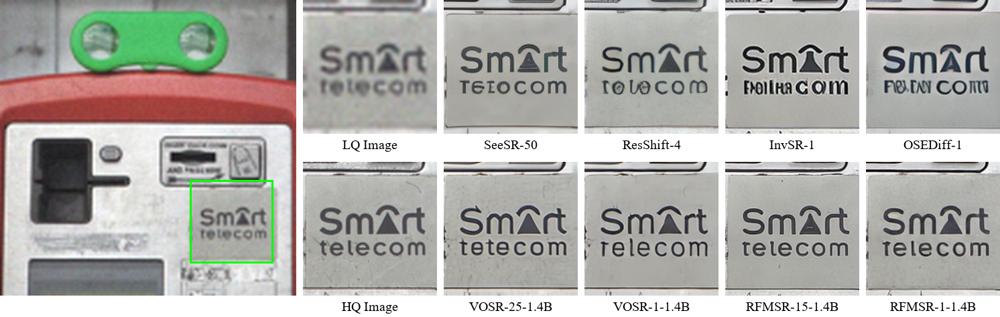
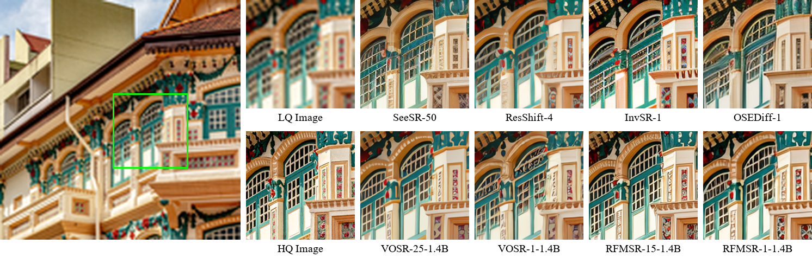

<div align="center">

# RFMSR: Residual Flow Matching for Image Super-Resolution

[](https://arxiv.org/abs/2607.12753)
[](https://huggingface.co/frozen2001/RFMSR)

</div>

<p align="center">
  
</p>
<p align="center"><em>Overview of the RFMSR framework. <b>Forward:</b> the residual flow progressively injects noise into the HQ latent along the residual path (HQ → LR). <b>Reverse:</b> the network learns to denoise and recover the HQ latent from the LR condition, yielding the SR result.</em></p>


## News

- **2026-11** — Added the RFMSR-1.4B backbone.
- **2026-07** — Initial release: training & inference code, one-step and multi-step checkpoints.


## Preparation

### Hardware Requirements

- **Inference**: >= 16 GB GPU VRAM
- **Training**: >= 48 GB GPU VRAM

### Installation

**Python >= 3.10** (recommended 3.10 ~ 3.12)

```bash
# 0. Create virtual environment (recommended)
conda create -n rfmsr python=3.12 -y
conda activate rfmsr

# 1. Install PyTorch (CUDA version)
pip3 install torch torchvision --index-url https://download.pytorch.org/whl/cu130

# 2. Install other dependencies
pip install -r requirements.txt

# 3. (Optional) Install xformers for memory-efficient attention
pip install xformers
```

### Pretrained Weights

All pretrained weights are available at [frozen2001/RFMSR](https://huggingface.co/frozen2001/RFMSR). Download the `ckpts/` folder to the RFMSR project root.

```bash
# 1. Install huggingface-cli
pip install huggingface_hub

# 2. Download the ckpts/ folder to RFMSR project root
huggingface-cli download frozen2001/RFMSR ckpts --local-dir .
```

Expected layout:

```
ckpts/
├── RFMSR_0.5B/                 # 4-channel SD2.1 latent space
│   ├── rfmsr.safetensors
│   ├── rfmsr_os.safetensors
│   └── rfmsr_consistency.safetensors
├── RFMSR_1.4B/                 # 16-channel Qwen-Image latent space
│   ├── rfmsr.safetensors
│   └── rfmsr_os.safetensors
├── stable-diffusion-2-1-base/vae/
├── Qwen-Image-vae-2d/
├── VOSR_0.5B_ms/checkpoints/ema_model.safetensors
├── VOSR_1.4B_ms/checkpoints/ema_model.safetensors
└── torch_cache/                # DINOv2 repo + weights, LPIPS / pyiqa backbones
```

| File | Description |
|------|-------------|
| `RFMSR_0.5B/rfmsr.safetensors` | Phase I — multi-step model, 0.5B backbone |
| `RFMSR_0.5B/rfmsr_os.safetensors` | Phase II — one-step model, 0.5B backbone |
| `RFMSR_0.5B/rfmsr_consistency.safetensors` | Consistency distillation — one-step model, 0.5B backbone |
| `RFMSR_1.4B/rfmsr.safetensors` | Phase I — multi-step model, 1.4B backbone |
| `RFMSR_1.4B/rfmsr_os.safetensors` | Phase II — one-step model, 1.4B backbone |
| `stable-diffusion-2-1-base/vae/` | SD2.1 VAE (4-channel latent), required by RFMSR-0.5B |
| `Qwen-Image-vae-2d/` | Qwen-Image VAE (16-channel latent), required by RFMSR-1.4B |
| `VOSR_0.5B_ms/`, `VOSR_1.4B_ms/` | VOSR DiT weights used to initialise Stage-1 training |
| `torch_cache/` | Cached DINOv2 repo/weights and metric backbones (auto-downloaded if missing) |

DINOv2 weights are pulled from GitHub on first use and cached in `ckpts/torch_cache`. For offline machines, pre-populate the cache:

```bash
modelscope download --model LULALULALU/VOSR_CKPT --include 'torch_cache/**' --local_dir ckpts
```

### Data Preparation

Training data (`traindata/`): place HR images (DIV2K, Flickr2K, etc.) directly under this directory.

Validation data (`assets/validate_gt/`, `assets/validate_lq/`): paired 512x512 HR and 128x128 LR images for validation during training.

Test data (`testdata/`): LSDIR and ImageNet512 test splits are included; put RealSR (Canon/Nikon) under `testdata/RealSR/{LR,HR}` for evaluation.


## Model Zoo & Configuration

### Backbones

The architecture lives in a *backbone* config, everything else (data, optimiser, losses, logging) lives in an *experiment* config.

| Backbone | DiT | Latent | VAE | DINOv2 | Checkpoint |
|----------|-----|--------|-----|--------|------------|
| `configs/backbones/rfmsr_0.5b.yaml` | 1024 wide, 28 blocks | 4-ch | SD2.1 | ViT-B (block 8) | `ckpts/RFMSR_0.5B/` |
| `configs/backbones/rfmsr_1.4b.yaml` | 1536 wide, 36 blocks | 16-ch | Qwen-Image | ViT-L (block 17) | `ckpts/RFMSR_1.4B/` |

### Config Files

```
configs/
├── backbones/
│   ├── rfmsr_0.5b.yaml          # DiT + VAE + DINOv2 spec
│   └── rfmsr_1.4b.yaml
├── infer_rfmsr.yaml             # inference defaults
├── train_rfmsr.yaml             # Phase I
├── train_rfmsr_os.yaml          # Phase II
└── realesrgan_degradation.yaml  # degradation pipeline
```

An experiment config selects a backbone through its `backbone:` field; the backbone file supplies `ae` (VAE type, path, latent channels), `dit_arch` and `dinov2`, and the experiment file overrides anything else. `utils/config_loader.py` resolves relative paths and rejects inconsistent combinations (e.g. `dit_arch.out_channels` ≠ `ae.latent_channels`).

Switch backbone from the command line, for both training and inference:

```bash
# Stage 1
python train_rfmsr.py --backbone configs/backbones/rfmsr_1.4b.yaml

# Stage 2 (also point pretrained_ckpt at the 1.4B Phase-I weights)
python train_rfmsr_os.py --backbone configs/backbones/rfmsr_1.4b.yaml

# Inference
python infer_rfmsr.py --input input.png --backbone configs/backbones/rfmsr_1.4b.yaml \
       --rfmsr_path ckpts/RFMSR_1.4B/rfmsr_os.safetensors --steps 1
```

The checkpoint must match the backbone: 4-channel weights only load into the 0.5B model, 16-channel weights only into the 1.4B model. For Stage 2 this means `pretrained_ckpt` in `configs/train_rfmsr_os.yaml` must point at a Phase-I checkpoint of the same size (e.g. `ckpts/RFMSR_1.4B/rfmsr.safetensors`).


## Training

### Stage 1: Multi-step Flow Matching

Train the LightningDiT with Residual Flow Matching (velocity prediction):

```bash
python train_rfmsr.py
```

Checkpoints are written to `<experiment.save_dir>/checkpoints/`: `rfmsr_step<N>.safetensors` (EMA weights for inference) and `training_state_step<N>.pth` (full state for `--resume`).


### Stage 2: One-Step Training

Train a one-step generator with perceptual and adversarial losses:

```bash
python train_rfmsr_os.py
```

Both training scripts accept `--config`, `--backbone` and `--resume`:

```bash
python train_rfmsr.py --backbone configs/backbones/rfmsr_1.4b.yaml
python train_rfmsr_os.py --resume experiments/checkpoints/training_state_step20000.pth
```


## Inference

### Quick Start

```bash
# One-step inference (fast, recommended)
python infer_rfmsr.py --input input.png --steps 1

# Multi-step inference (higher quality) — use the Phase-I checkpoint
python infer_rfmsr.py --input input.png \
       --rfmsr_path ckpts/RFMSR_0.5B/rfmsr.safetensors --steps 15

# Process a folder
python infer_rfmsr.py --input ./test_images/ --scale 4.0 \
       --rfmsr_path ckpts/RFMSR_0.5B/rfmsr.safetensors --steps 15

# RFMSR-1.4B backbone
python infer_rfmsr.py --input input.png --backbone configs/backbones/rfmsr_1.4b.yaml \
       --rfmsr_path ckpts/RFMSR_1.4B/rfmsr_os.safetensors --steps 1
```

### Command-Line Arguments

| Argument | Default | Description |
|----------|---------|-------------|
| `--input` | (required) | Input image or directory |
| `--rfmsr_path` | `ckpts/RFMSR_0.5B/rfmsr_os.safetensors` | Path to RFMSR checkpoint |
| `--backbone` | `configs/backbones/rfmsr_0.5b.yaml` | Backbone config (DiT + VAE + DINOv2) |
| `--scale` | 4.0 | Upscale factor |
| `--steps` | 1 | Reverse integration steps (1 for one-step) |
| `--flow_sigma` | 1.0 | Noise standard deviation |
| `--seed` | 42 | Random seed |
| `--color_correction` | wavelet | Color correction: `adain` / `wavelet` / `ycbcr` / `none` |
| `--chopping` | True | Tiled latent inference (kicks in when the image exceeds the tile size) |
| `--tile_size` | 512 | Pixel-space tile size |
| `--tile_stride` | 256 | Sliding window stride |
| `--vae_path` | from backbone config | Override the VAE path |
| `--denoise_device` | cuda | Device for RFMSR + VAE |
| `--output` | outputs | Output directory |

All defaults come from `configs/infer_rfmsr.yaml`; CLI flags override them.

### One-Step vs Multi-Step

| Mode | Checkpoint | Steps | Speed | Quality | Use Case |
|------|------------|-------|-------|---------|----------|
| One-step | `rfmsr_os.safetensors` | 1 | Fast | Good | Real-time / batch processing |
| Multi-step | `rfmsr.safetensors` | 15 | Slower | Best | Maximum quality |


## Evaluation

Run the metrics script to compute PSNR, SSIM, LPIPS, DISTS, FID, NIQE, MUSIQ, MANIQA, and CLIPIQA between SR results and GT images (paired by filename):

```bash
python utils/cal_metrics.py --gt_dir testdata/LSDIR/test_gt --sr_dir outputs/LSDIR
```

| Argument | Default | Description |
|----------|---------|-------------|
| `--gt_dir` | (required) | Ground-truth (HR) directory |
| `--sr_dir` | (required) | SR result directory |
| `--bs` | 1 | Batch size |
| `--log_name` | `metrics.log` | Log file, written next to `--sr_dir` |
| `--no_y_channel` | off | Use RGB instead of the Y channel for PSNR / SSIM |


## Repository Layout

```
RFMSR/
├── infer_rfmsr.py                # inference entry
├── train_rfmsr.py                # Stage 1: multi-step flow matching
├── train_rfmsr_os.py             # Stage 2: one-step adversarial training
├── configs/
│   ├── backbones/                # DiT + VAE + DINOv2 spec per model size
│   ├── infer_rfmsr.yaml
│   ├── train_rfmsr.yaml
│   ├── train_rfmsr_os.yaml
│   └── realesrgan_degradation.yaml
├── models/
│   ├── lightningdit.py           # LightningDiT backbone
│   ├── rfmsr.py                  # RFMSR wrapper: [z_lr, x_t] → velocity
│   ├── latent_codec.py           # unified SD2.1 / Qwen-Image VAE interface
│   ├── qwenimage_vae2d.py        # 16-channel Qwen-Image VAE
│   └── dinov2_encoder.py         # frozen DINOv2 conditioning
├── datapipe/                     # Real-ESRGAN degradation + dataset
├── utils/                        # config loading, losses, color fix, metrics
└── assets/                       # figures
```


## Visual Comparisons

Below are qualitative comparisons on benchmark datasets. Each figure shows the low-quality (LQ) input, ground-truth high-quality (HQ) image, and results from competing methods (SeeSR, VOSR, ResShift, InvSR, OSEDiff) alongside RFMSR in both multi-step (15-step) and one-step modes. RFMSR preserves fine textures, text clarity, and natural details while avoiding hallucination and artifacts.

### Portrait

<p align="center">
  
</p>
<p align="center"><em>Portrait super-resolution (4×, RFMSR-0.5B).</em></p>

### Text & Logo

<p align="center">
  
</p>
<p align="center"><em>Text and logo super-resolution (4×, RFMSR-1.4B).</em></p>

<p align="center">
  
</p>
<p align="center"><em>Another text example (4×, RFMSR-1.4B).</em></p>

### Architecture

<p align="center">
  
</p>
<p align="center"><em>Architecture super-resolution (4×, RFMSR-1.4B).</em></p>


## Contact

For questions or collaboration, please open an issue on GitHub or contact [frozen2001@hust.edu.cn](mailto:frozen2001@hust.edu.cn).

## Acknowledgements

This project builds upon the following open-source works:

- [VOSR](https://github.com/CSWRY/VOSR)
- [Stable Diffusion 2.1](https://huggingface.co/Manojb/stable-diffusion-2-1-base)
- [Qwen-Image](https://github.com/QwenLM/Qwen-Image)
- [DINOv2](https://github.com/facebookresearch/dinov2)
- [Real-ESRGAN](https://github.com/xinntao/Real-ESRGAN)
- [LPIPS](https://github.com/richzhang/PerceptualSimilarity)
- [BasicSR](https://github.com/XPixelGroup/BasicSR)
- [PyIQA](https://github.com/chaofengc/IQA-PyTorch)

## Citation

If you find this work useful, please cite:

```bibtex
@misc{huang2026rfmsrresidualflowmatching,
      title={RFMSR: Residual Flow Matching for Image Super-Resolution},
      author={Shuwei Huang and Tianyao Luo and Jicheng Liu},
      year={2026},
      eprint={2607.12753},
      archivePrefix={arXiv},
      primaryClass={cs.CV},
      url={https://arxiv.org/abs/2607.12753},
}
```
